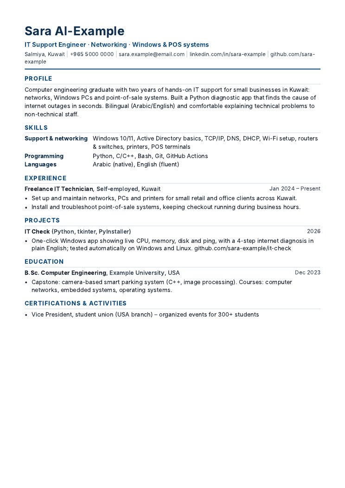
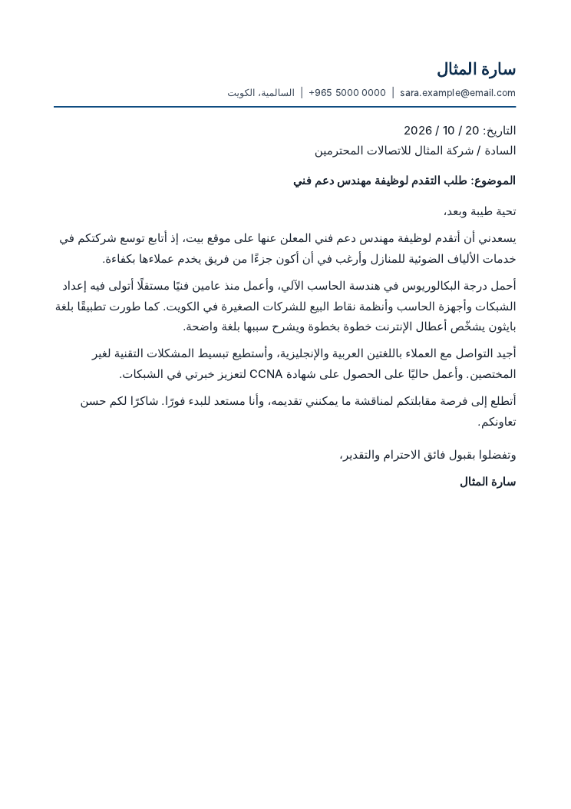

# Kuwait Job Search

An AI job-search assistant for **Kuwait**, built on [Claude Code](https://docs.claude.com/en/docs/claude-code/overview).
It finds jobs on Kuwait's job boards and employer sites, scores each one honestly against
your profile, writes a tailored CV and cover letter (**English or Arabic**) as PDFs, tracks
your applications, and prepares you for interviews.

Everything runs on your own computer. Your CV, profile and applications never leave it,
and they are never uploaded to GitHub.

<p>
  
  
</p>
<sub>Samples made for a fictional candidate. See <a href="examples">examples/</a>.</sub>

## Why a Kuwait version?

General AI job tools assume Europe or the US. Job hunting in Kuwait works differently:

- Jobs are spread across **Bayt, LinkedIn, GulfTalent, NaukriGulf** and employer career pages,
  especially the **KPC oil group, banks and telecom companies**.
- The right route depends on **nationality**: Civil Service Commission (CSC) registration for
  government jobs, private-sector support for Kuwaiti citizens, and work permits and
  engineering accreditation (KSE) for residents.
- Employers ask for specific **documents**: Civil ID, degree equivalency for foreign degrees,
  KSE membership for engineering titles.
- **Arabic** cover letters are expected by many government bodies.
- Many people want **Sharia-compliant employers** only. `/setup` asks you, and then `/search`
  and `/apply` skip or flag conventional banks and other non-compliant employers, and ask you
  about unclear cases. See [`knowledge/sharia-compliance.md`](knowledge/sharia-compliance.md).
- **Job scams** that ask for "visa fees" are common, so every posting is checked for warning signs.

The guide in [`knowledge/kuwait-job-market.md`](knowledge/kuwait-job-market.md) holds all of this,
with sources. Claude is told to re-check government rules before stating them, because they change.

## What it does

| Command | What happens |
| --- | --- |
| `/setup` | Reads your CV from `documents/`, asks you a few questions (including nationality and whether you want Sharia-compliant employers only) and builds your private profile and search preferences |
| `/search` | Searches Kuwait job boards and employer sites, skips jobs you've already seen, scores the rest out of 100 and adds the good ones to your tracker |
| `/apply <link>` | Checks the posting for scams and hidden AI instructions, scores your fit, then (if you say yes) researches the company, drafts a tailored CV and cover letter, gets an independent "hiring manager" review, renders the PDFs and runs a pass/fail checklist |
| `/interview <id>` | Writes a prep pack: introduction, likely questions with answers from your real experience, gap questions, salary research in KWD, questions to ask, and a mock interview |
| `/track` | Shows your pipeline, updates statuses and drafts polite follow-up emails for applications that have gone quiet |

## Ground rules built in

- **It never makes things up.** Your CV only contains facts from your profile. Gaps stay visible.
- **Postings are treated as untrusted.** `tools/posting_guard.py` strips hidden text and flags
  "instructions to the AI" and scam signs before Claude reads a posting.
- **It respects websites.** Normal searches and page fetches only: no logging in, no scraping
  LinkedIn, no bypassing blocks. If a page refuses, you paste the text.
- **You stay in control.** It prepares documents and drafts. It never submits applications or
  sends messages for you.

## Requirements

- Windows 10/11 (macOS and Linux work too)
- [Claude Code](https://docs.claude.com/en/docs/claude-code/overview) with a Claude Pro or Max plan, or API credits
- [Python 3.10+](https://www.python.org/downloads/)
- Microsoft Edge or Google Chrome (already on Windows) to make the PDFs. No LaTeX or Word needed.

## Setup

1. **Get your own copy.** Click **Fork** at the top of this page. Your personal files are
   git-ignored, so even a public fork won't publish them. (Prefer extra privacy? Create a
   private repository and push a clone of this one to it.)
2. **Download it:**
   ```
   git clone https://github.com/<your-username>/kuwait-job-search.git
   cd kuwait-job-search
   ```
3. **Add your CV:** put your current CV (PDF, Word or text) in the `documents/` folder.
4. **Start Claude Code** in the folder and build your profile:
   ```
   claude
   /setup
   ```
5. **Find jobs:** `/search`, then `/apply <link>` on the ones you like.

## Project layout

```
.claude/commands/   setup, search, apply, interview, track (the slash commands)
.claude/agents/     application-reviewer (hiring-manager review, read-only)
knowledge/          Kuwait job market guide, Sharia-compliance rules, scoring rules, writing rules
templates/          CV and cover letter templates (HTML → PDF), English and Arabic
tools/              tracker.py, render_pdf.py, posting_guard.py (Python, standard library only)
profile/            your profile and search preferences (templates only on GitHub)
documents/          your CVs and certificates (never committed)
applications/       one folder per application + tracker.csv (never committed)
examples/           sample CV and Arabic cover letter for a fictional candidate
tests/              unit tests, run on Windows and Linux by GitHub Actions
```

## Tools you can also run yourself

```
python tools/tracker.py list                       # your applications
python tools/tracker.py update 3 --status applied  # after you submit
python tools/tracker.py followups --days 10        # who to chase
python tools/posting_guard.py posting.html         # clean and check a posting
python tools/render_pdf.py applications/zain_it-support/cv.html --expect-pages 1
```

## Tests

```
python -m unittest discover -s tests -v
```

## Credits

Inspired by [ai-job-search](https://github.com/MadsLorentzen/ai-job-search) by Mads Lorentzen
(MIT), which does the same for the Danish job market. This project is a separate, Kuwait-focused
implementation with its own tools and templates.

Built by [Omar Aldaihani](https://github.com/omar-aldaihani), computer engineering graduate.
Not affiliated with Anthropic or with any job site or government body named here.

## License

MIT. See [LICENSE](LICENSE).
